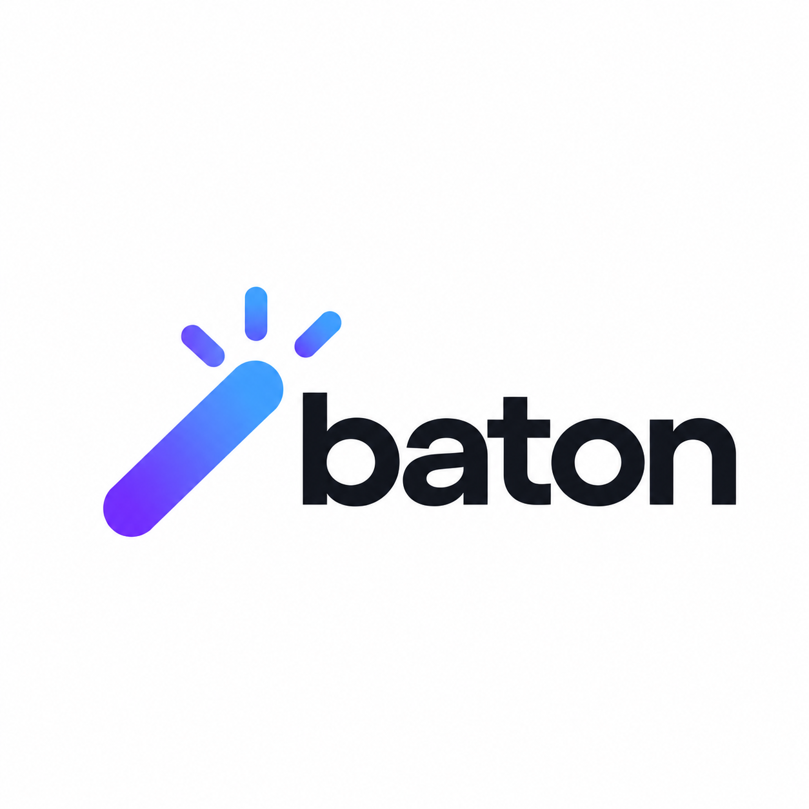

<p align="center">
  
</p>

<p align="center">
  Local project coordination across independent Git repositories.
</p>

<p align="center">
  <a href="https://www.python.org/downloads/"></a>
  
  <a href="LICENSE"></a>
</p>

Baton is a CLI for running projects that span several repositories and several
agents at once. It manages Git worktrees for each participating repository, keeps
plans, reviews, and retrospectives in a shared artifact checkout, and gives
coordinating agents a shared blackboard and task list with ownership rules.
Codex, Claude Code, Antigravity, and Cursor are built-in providers: any of them can
own a project, and they run the review and retrospective workflows. The runtime uses only the Python standard library.

## Operating principles

- **Everything is a project.** Work is organized into projects, each with a name,
  a set of participating repositories, a plan, and a retrospective at the end.
- **Ten projects is the human limit.** A person can realistically keep track of
  about ten concurrent projects, so Baton provides exactly ten coordinator slots.
  The slots stay fixed; as agents become more capable, what fits in one project
  grows.
- **One terminal, ten tabs.** A terminal with one tab per slot is enough to work
  on and keep track of every active project from a single place.
- **One point of contact per project.** Each project has a project manager agent
  that owns the session and coordinates workers and reviewers. The human talks to
  that agent, not to every worker.
- **Nothing is thrown away.** Plans, reviews, notes, and coordination history are
  not always part of a project's deliverables, but they are always organized and
  retained in the project's artifact directory.
- **Tool reuse.** Certain problems are already solved. There are great coding
  agents (Codex, Claude Code, Antigravity, etc.) and terminals with agent
  integrations to use them from. Baton builds on top of those as a
  relatively thin orchestration and management layer.
- **Flexibility and no lock-in.** Nothing in Baton is tied to any specific
  provider or tool.

## Requirements

- Python 3.13+
- Git and Bash
- [`uv`](https://docs.astral.sh/uv/) for installation
- GitHub CLI (`gh`) for pull request and native stack operations
- Optional: Codex, Claude Code, Antigravity, or Cursor as project owners, reviewers and retro authors

## Install

Clone the repository and run the installer from a clean `main` checkout; see the
[installation guards](docs/installation.md#full-install).

```sh
git clone https://github.com/pkozikow/baton.git
cd baton
./install.sh
baton config show                       # review storage roots; change them now if needed
baton init                              # create the slots, worktrees root and, for the default root, the artifact repo
baton doctor                            # verify the CLI, paths and review models
```

Configure [storage roots](docs/configuration.md#storage-roots) before `baton init`.
Installation enables `codex`, `claude` and `agy` as default reviewers, and
`baton doctor` fails when any of their CLIs is missing; to drop a provider, see
[Diagnostics](docs/installation.md#diagnostics-baton-doctor).
[Installation](docs/installation.md) covers updates, PATH setup, cron, skill-only
and CLI-only installs.

## Quick start

```sh
cd <slots_root>/p1                      # default ~/dev/baton-wt
baton create example --repos example-repo /absolute/path/to/other-repo
baton status --json                     # authoritative paths for this project
baton handoff --agent worker --repo example-repo   # worker paths and rules
```

`baton init` creates ten coordinator slots, `p1` through `p10`. A project lives in
one slot, owns a worktree per participating repository on a `<branch-prefix>/<project>` branch (`baton/<project>` by default),
and stores its plans and retro under the artifact root. When the work is merged,
`baton cleanup` seals the coordination history and releases the worktrees.
`baton cleanup --force` warns and confirms a best-effort local cleanup when normal
cleanup is blocked; it prioritizes making the slot reusable and reports leftovers.
`baton abandon [PROJECT]` confirms and closes project PRs before regular cleanup.
From a coordinator slot, `baton create follow-up --from FULL_UUID` starts a fresh
project from an archived predecessor, automatically named `example-followup`, then
`example-followup2` when following that closed project. See [project lifecycle](docs/projects.md).

## Find and revisit projects

From any directory, search current and completed projects using literal keywords
and quoted phrases. All terms must match somewhere within the same project.

```sh
baton search 'token "refresh rotation"' --json
baton search 'refresh' --state archived --limit 50
baton session show --selector PROJECT_NAME
baton session fork --selector PROJECT_UUID
```

Results include evidence excerpts, lifecycle state, artifact paths and stable
UUIDs. Use the chosen UUID when names have been reused. Ask your agent to inspect
candidates and clarify ambiguous matches. A closed project's fork runs in its
first recorded repository source checkout and keeps the project closed.
See [Project discovery](docs/projects.md#project-discovery) for coverage and
[Sessions and ownership](docs/projects.md#sessions-and-ownership) for fork behavior.

## Concepts

- **Coordinator slot**: a metadata-only checkout of the coordinator repository that
  hosts one active project. Code changes never happen here.
- **Code worktree**: one Git worktree per registered repository and branch. Paths
  come from `baton status --json`, never from branch names.
- **Artifacts**: the master plan, per-branch subplans, and the retrospective, kept in
  a shared Git checkout and committed with `baton artifacts commit`.
- **Session ownership**: the first top-level agent, from any registered provider,
  claims the project with `baton session claim`. Ownership is permanent; forks
  inherit history only, and providers without a native fork start fresh sessions.
- **Blackboard and tasks**: a SQLite board for agent notes, decisions, and
  project-local tasks with blocking prerequisites and optimistic versioning.
  Workers settle tasks with explicit outcomes and ask blocking questions; parents
  wait on questions and settlements from a cursor.
- **Skills**: bundled agent instructions for discovery, planning, review, and retros.

Storage roots, repository aliases, review models, model tiers and worker model
preferences are described in [Configuration](docs/configuration.md). The bundled
`baton-*` agent skills and their invocation policy are listed in
[Skills and reviews](docs/skills.md).

## Documentation

- [Installation](docs/installation.md): cron job, skill-only and CLI-only installs, `baton doctor`
- [Projects](docs/projects.md): slots, worktrees, artifacts, branches, sessions, retirement
- [Configuration](docs/configuration.md): storage roots, aliases, providers, review and worker models
- [Skills and reviews](docs/skills.md): bundled skills and review execution
- [Blackboard and tasks](docs/blackboard-and-tasks.md): SQLite board, tasks, export, sealing
- [Retrospectives](docs/retrospectives.md): interactive and unattended retros, plus weekly cross-project reports
- [Changelog](CHANGELOG.md): changes and supported formats

## Development

Install the locked development environment, including the build backend used by
packaging tests:

```sh
uv sync --locked
```

Run tests targeted to your change locally. The runner accepts module names, case
IDs and discovery filename patterns:

```sh
uv run --locked python run_tests.py test_run_tests
uv run --locked python run_tests.py test_storage_names.RegistryPathsTest.test_missing_registry_is_resolved_without_writes
uv run --locked python run_tests.py --pattern 'test_project_artifacts.py'
uv run --locked python run_tests.py --start-directory agent-skills/tests test_plan_peer_review
uv run --locked python run_tests.py --start-directory agent-skills/tests --pattern 'test_review_models.py'
```

CI runs both complete test roots and builds the package. Reserve these full-suite
commands locally for major/cross-cutting changes, test harness changes, explicit
requests or diagnosis requiring broad coverage:

```sh
mkdir -p experiments/ci
uv run --locked python run_tests.py --jobs 4 --json-report experiments/ci/core.json
uv run --locked python run_tests.py --start-directory agent-skills/tests --jobs 4 --json-report experiments/ci/skills.json
uv build --no-build-isolation --python .venv/bin/python
uv run --locked python check_ci_reports.py experiments/ci
```

The default discovery root is `tests/`; skill review tests under
`agent-skills/tests/` require the second command. Tests need Git, Bash and a
compatible [native `gh stack` extension](https://github.com/github/gh-stack).
The build uses the locked development backend and its dependencies. Use
`--jobs 1` for serial execution and `--json-report PATH` to record timings.

The optional [search benchmark](tests/test_project_search_performance.py) reports
scan/invocation timings and peak RSS without a CI latency assertion:

```sh
BATON_SEARCH_BENCHMARK=1 uv run --locked python tests/test_project_search_performance.py
```

Contribution guidelines live in [AGENTS.md](AGENTS.md). Before testing an unmerged
Baton runtime, read [isolated WIP testing](docs/installation.md#isolated-wip-config-and-skill-testing).

## License

[MIT](LICENSE)
